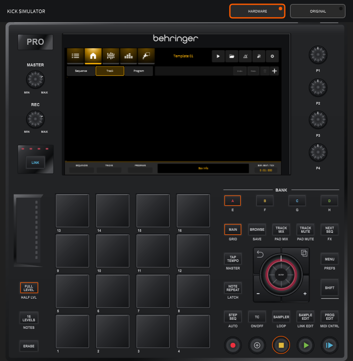
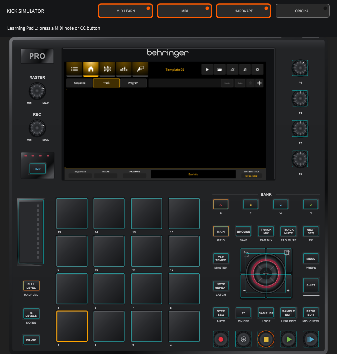

# KICK Firmware: User Manual (community build)

This manual describes community simulator v0.1.4 and the Behringer KICK firmware sources in this repository. Windows x64 and Linux x86_64 desktop builds are available. Nothing here is an official manufacturer release. Physical hardware is unavailable for acceptance testing. It covers:

- the desktop app (`Kick.exe`);
- the hardware simulator (`KT_KickEM.exe` on Windows, `KT_KickEM` on Linux);
- what the firmware does on the device.

No official manual exists yet, so this one was put together in two ways. First, the UI and engine source was read screen by screen. Second, the test harness was run against the actual build:

- **the engine test runner** (`KickEngineTest`; current validation counts are in [RELEASE-NOTES.md](../../../RELEASE-NOTES.md)), and
- **the simulator tour** (`KICKEM_SELFTEST=tour`). The tour loads a kit and presses every front-panel button and its SHIFT function. On each screen it turns every Q-link, turns the jog wheel and hits a pad, then logs the screen it lands on and takes a snapshot.

The screenshots in this manual come from that tour.

Each feature is marked with how much is known about it:

| Mark | Meaning |
|---|---|
| ✅ | **Tested.** Exercised by the engine tests or a simulator self-test in this build. |
| 🔍 | **From code.** Described from reading the source; not driven by a test. |
| ⚠️ | **Partial.** Parts of the screen work; the caveats are listed. |
| ❌ | **Not implemented.** The button or control exists but does nothing yet. |

Most of the firmware is **unfinished upstream**. MUSIC Tribe released it as a work in progress, and a lot of the UI is laid out without a working engine behind it yet. Section 15 lists those gaps in one place.

---

## Contents

1. [Running it](#1-running-it)
2. [The front panel](#2-the-front-panel)
3. [Core concepts](#3-core-concepts)
4. [Projects](#4-projects)
5. [Main mode](#5-main-mode)
6. [Playing the pads](#6-playing-the-pads)
7. [Grid view](#7-grid-view)
8. [Step sequencer](#8-step-sequencer)
   - [8a. Recording pads into a sequence](#8a-recording-pads-into-a-sequence-)
9. [List edit, Next Sequence and Song](#9-list-edit-next-sequence-and-song)
10. [Programs and Program Edit](#10-programs-and-program-edit)
11. [Sampling: Sampler, Looper, Sample Edit, Browser](#11-sampling-sampler-looper-sample-edit-browser)
12. [Mixing: mixers, mutes, inserts, XY FX](#12-mixing-mixers-mutes-inserts-xy-fx)
13. [Performance and control](#13-performance-and-control)
14. [Preferences](#14-preferences)
15. [Feature status and known gaps](#15-feature-status-and-known-gaps)
16. [For developers: the test harness](#16-for-developers-the-test-harness)

---

## 1. Running it

There are two ways to run the firmware on a PC.

**`Kick.exe`** (in `build/win`) shows the touchscreen UI on its own, at 1024×600. With no front panel attached, you drive it with the mouse (as a touchscreen) and the PC keyboard. Some flows assume the hardware buttons and can't be finished with the mouse. Creating a program with **+** is one example. For those, use the simulator.

**`KT_KickEM.exe`** is the **simulator** (`build/sim` for local Debug builds, `build/dist` for the distributable Release build). It draws the front panel around the real UI: pads, Q-links, jog wheel, touch slider and buttons. Panel input goes through the firmware's hardware input path, and the firmware drives its pad and button LEDs. The portable Windows release runs from its extracted folder: keep `assets`, `templates` and `demos` alongside the executable. Open Settings > Audio to choose a Windows audio device. The public package has ASIO disabled.

**Linux:** extract the Linux x86_64 `.tar.gz` into a writable folder and run `./launch.sh`. The native executable is `KT_KickEM`. It requires glibc 2.35 or newer and an X11/XWayland session; [Linux setup](../../how-to/release-simulator.md#linux-desktop) lists runtime/build dependencies. Choose an ALSA or JACK device in Settings > Audio. Assets, templates, demos, projects and preferences resolve beside the executable; `KICK_PREFS_DIR` can override the preferences location. Embedded I2C/CV, USB gadget, firmware update, network configuration and host power controls are disabled in desktop builds.

### Using the simulator panel



- **Layout:** the toolbar switches between **Hardware**, which follows the physical KICK panel, and **Original**, the wide simulator interface. Your choice is remembered. Switching keeps the same live screen, controls and LEDs.
- **Artwork:** the hardware panel is an embedded SVG, so it stays sharp when the window is resized. Hover a control to see its function and mouse interaction.
- **Buttons:** click to press.
- **SHIFT functions** (the second label on a button) can be reached two ways:
  - Click **SHIFT** first. It latches for the next button press, and the SHIFT labels brighten while it's latched.
  - Or hold the PC **Shift** key while clicking the button.
- **Pads:** click a pad to hit it. Clicking near the top of the pad gives a louder hit than clicking near the bottom.
- **Knobs:** drag a Q-link, or use the mouse wheel over it.
- **Jog / Enter:** drag around the jog wheel or scroll to turn it; click its centre for Enter. The four surrounding corners are BACK, COPY, minus and plus.
- **MASTER / REC:** these represent analog gain controls on the hardware and remain visual references in the simulator.

### Mapping a MIDI controller

Community simulator v0.1.4 includes MIDI learn on Windows and Linux. It maps external controllers to the simulator's panel in either layout.



1. Connect your MIDI controller. Inputs open automatically; the toolbar's **MIDI** menu lists connected inputs.
2. Right-click a pad, button, Q-link, jog wheel or touch strip and choose **Learn MIDI**. Press a controller pad/button or move its knob/fader. The status line confirms the assignment. This first gesture learns the mapping without playing the pad or activating the button.
3. To map several controls, turn on **MIDI LEARN** in the toolbar. Mappable controls have cyan outlines; click one to select it in orange, then move the controller. Repeat for other controls. Turn the mode off, or press **Esc**, to play normally.

Pads and buttons accept MIDI notes or CCs. Pad note velocity and polyphonic/channel pressure are preserved. For a button that sends only press messages, choose **Learn MIDI trigger button (press only)**; it generates a complete press/release for each nonzero value. The default mode expects a momentary press/release pair. Use that default for SHIFT or ERASE. MIDI SHIFT remains held across successive button presses until the controller releases it; the mouse SHIFT latch remains independently one-shot.

Q-links and jog rotation require CCs. Ordinary knobs use **Learn MIDI**: absolute CC movement becomes signed encoder steps, with the first value after restart establishing a baseline to avoid a jump. Endless encoders can use **Learn relative encoder** with two's complement (1/127), offset (65/63), or sign magnitude (1/65), matching the controller's configuration. Movement is limited to 16 firmware detents per incoming message. The touch strip uses absolute CC 0–127 across its full range. The jog's **Enter** push and a button's alternate SHIFT command are separate choices in its right-click menu.

Mappings identify the input device, channel and note/CC number. Each input controls one target; learning it elsewhere replaces its old assignment. Each target keeps one assignment. The **MIDI** menu lists mapped controls, supports removing/clearing assignments, bypasses mappings, and releases held controls. Right-click also shows a control's current assignment. Controller port identifiers can change when moving USB ports; relearn an affected assignment if necessary.

Cancelling an unfinished assignment preserves the previous bypass state. MIDI switch controls CC64–69 use values 0–63 for off and 64–127 for on; a release cannot become a learned button press. Channel-mode commands CC120–127 remain routed to the engine and cannot be learned, including when reading saved mappings. Reset All Controllers releases mapped CC switches while leaving held note controls intact. These ranges follow the [MIDI Association control-change reference](https://midi.org/midi-1-0-control-change-messages).

Mappings save automatically to `simulator-midi.json` in the preferences folder (`prefs` beside the executable, or `KICK_PREFS_DIR`). They survive restart and layout changes and apply across projects. They are personal preferences and are excluded from release packages. Save failures appear in the status line.

Mapped events enter the same firmware packet path as mouse input and are consumed before musical MIDI routing, preventing duplicate notes. Unmapped MIDI continues to tracks. Learn mode consumes notes/CCs while assigning controls; note-offs for keyboard notes already held before learning still reach their tracks. Bypass, unmap, disconnect and MIDI All Notes Off release mapped held controls. The analog MASTER/REC references and controls inside the touchscreen are outside this mapping layer; map Q-links and panel navigation to operate the active screen.

### PC keyboard shortcuts 🔍

Both apps accept these keys. The pad keys are laid out the same way as the pads, with the bottom row first.

| Keys | Panel control |
|---|---|
| `Z X C V` / `A S D F` / `Q W E R` / `1 2 3 4` | Pads 1–4 / 5–8 / 9–12 / 13–16 |
| `F1`–`F4`, `F6`–`F8` | Bank A–D, F–H (bank E has no key) |
| `Space` / `F12` / `F11` | PLAY / PLAY START / STOP |
| `F9` / `F10` | REC / OVERDUB |
| `↑` `↓` / `Enter` | Jog wheel turn / jog wheel push |
| `←` `→` | − / + |
| `T` `Y` `U` `I` `O` | MAIN, BROWSE, TRACK MIX, TRACK MUTE, NEXT SEQ |
| `5` `6` `7` `8` `9` | GRID, SAVE, PAD MIX, PAD MUTE, FX |
| `G` `H` `J` `K` `L` | STEP SEQ, TC, SAMPLER, SAMPLE EDIT, PROGRAM EDIT |
| `B` `N` `M` `,` `.` | AUTOMATION, ON/OFF, LOOPER, LINK EDIT, MIDI CONTROL |
| `Esc` / `Insert` | MENU / PREFS |
| `Delete` / `Tab` / `PgUp` / `PgDn` | ERASE / LINK / BACK / COPY |
| `0` `P` `=` `]` `-` `[` | FULL LEVEL, HALF LEVEL, 16 LEVELS, NOTES, NOTE REPEAT, LATCH |

### Audio

Choose the audio device under **PREFS → Audio** (see section 14). On Windows, ASIO drivers are listed when the app was built with the ASIO SDK.

---

## 2. The front panel

On the panel, the label underneath each button is its **SHIFT** function. The tour pressed every button below, and the "Opens" column is what the app reported.

| Button | SHIFT function | What it does | Status |
|---|---|---|---|
| **MAIN** | **GRID** | Main mode / Grid view | ✅ |
| **BROWSE** | **SAVE** | File Browser / save the project now | ✅ / 🔍 |
| **TRACK MIX** | **PAD MIX** | Track Mixer / Pad Mixer | ✅ |
| **TRACK MUTE** | **PAD MUTE** | Track Mute / Pad Mute | ✅ |
| **NEXT SEQ** | **FX** | Next Sequence / XY FX | ✅ |
| **STEP SEQ** | **AUTOMATION** | Step Sequencer / *nothing yet* | ✅ / ❌ |
| **TAP TEMPO** | **MASTER** | *nothing yet* | ❌ |
| **NOTE REPEAT** | **LATCH** | *nothing yet* | ❌ |
| **TC** | **ON/OFF** | *nothing yet* (Timing Correct is in List Edit) | ❌ |
| **SAMPLER** | **LOOPER** | Sampler / Looper | ✅ |
| **SAMPLE EDIT** | **LINK EDIT** | Sample Editor / Q-Link Edit | ✅ |
| **PROGRAM EDIT** | **MIDI CONTROL** | Program Edit / MIDI Control | ✅ |
| **MENU** | **PREFS** | Menu / Preferences | ✅ |
| **16 LEVELS** | **NOTES** | *nothing yet* / Pad Perform ("Pad Notes") | ❌ / ✅ |
| **FULL LEVEL** | **HALF LEVEL** | Fixed-velocity toggles. Only the Step Sequencer reads them. | ⚠️ |
| **ERASE** | | Deletes selected notes in Grid; clears a pad in Assign Sample | 🔍 |
| **COPY** | | Duplicates the selected notes in Grid | 🔍 |
| **LINK** | | Stub; no visible effect | ❌ |
| **BACK** | | No effect. Use the on-screen ← arrow instead. | ❌ |
| **− / +** | | Step the focused value down or up | 🔍 |
| **Banks A–D** | **E–H** | Pick the pad bank (16 pads × 8 banks = 128 notes) | ✅ |
| **PLAY / PLAY START / STOP** | | Transport (see below) | ✅ |
| **REC / OVERDUB** | | Record pads into the sequence (section 8a). On the Sampler and Looper screens, they record audio instead. | ✅ |
| **Jog wheel** | push = ENTER | Move the selection / change the focused value; push to confirm or open | ✅ |
| **Q-links P1–P4** | | Edit whatever the current screen maps to them | ✅ |
| **Touch slider** | | Sends 0–100 to the focused control | 🔍 |
| **Master / REC GAIN knobs** | | Analog on the device; the software doesn't read them | 🔍 |

### Transport ✅

- **PLAY** plays the selected sequence from the current position.
- **PLAY START** plays it from the beginning.
- **STOP** pauses, so a second PLAY carries on from the same position.

Each screen handles the transport buttons itself. Main, Grid, Step Seq, Program Edit, the mixers and the mutes all do. Next Sequence and Song have their own play logic (section 9).

The tour confirmed that PLAY starts the loaded kit's beat and STOP stops it.

### How a control gets edited

1. **Tap a field** on the touchscreen to give it focus. While a field has focus, the jog wheel, **− / +** and the slider change it.
   - **Drop-down lists (▼) open on a double-tap.** With a mouse, that's a double-click. You can also focus the list and push the jog wheel (ENTER).
   - **In an open list,** tap an option, or turn the jog wheel and push ENTER. Dialogs open over the KICK screen; the panel keeps working while one is open.
2. **When nothing is focused,** the jog wheel and Q-links do the current screen's own job. For example, the jog scrolls lists and the Q-links edit the four parameters shown.
3. **Custom Q-link assignments:** if **Q-Link Edit** is set to *Custom*, the Q-links follow your custom assignments on every screen instead (section 13).

---

## 3. Core concepts

```
Project
 ├─ Sequences (patterns): name, BPM, bars, loop range, transpose
 │   └─ Tracks: one program each, plus note events, level, transpose, mute/solo, MIDI in
 ├─ Programs (the sound sources tracks play)
 ├─ Sample pool (assets), buses (outputs, returns, submixes), looper and sampler state
 └─ Songs (ordered lists of sequences)
```

### Program types

When you create a program you pick one of seven types:

| Type | What it plays |
|---|---|
| **Drum** | 128 pads, each with up to 4 sample layers, envelopes and an LFO |
| **Keygroup** | Samples mapped across the keyboard (note ranges, root notes) |
| **Clip** | Pads launch audio clips, with launch quantize |
| **Audio** | An audio-track arrangement: samples placed on the timeline |
| **Plugin / Instrument** | A built-in synth engine with scale-aware pads (new in this build) |
| **MIDI** | Sends notes and CCs out of a MIDI port |
| **CV** | Sends notes as CV/gate on the 8 CV outputs |

### Pads and banks

There are 16 pads and 8 banks (A–H), so a program can address 128 notes. For drum-style programs, pad 1 of bank A is note 0 and pad 16 of bank H is note 127. Instrument programs map pads to notes differently, through their pad layout (section 6).

---

## 4. Projects

On disk, a project is a folder:

```
My Song/
  My Song.kickPrj   (the whole project as XML)
  Samples/          (samples recorded or imported into the project)
  Export/
```

The `.kickPrj` file must have the same name as its folder. The app opens `<folder>/<folder name>.kickPrj`. If the names don't match, it quietly creates a new, empty project instead.

Where the folders live:

- **On the device:** `/home/Kick/projects`, `/app/demos`, `/app/templates`.
- **On desktop Windows/Linux:** `projects`, `demos` and `templates` folders next to the executable.

**Saving** 🔍 happens in three ways:

- **SHIFT + BROWSE** (SAVE) saves immediately.
- The project is also saved when you close it, load another one, or quit the app.
- Auto-save is listed in Preferences, but it isn't wired up yet (section 15).

### The startup screen (Recent Projects) 🔍

When the app starts, it shows three rows plus a button:

- **Demos:** the shipped demo projects.
  - A demo opens in place and isn't added to your recent list.
  - Saving overwrites the demo.
- **Templates:** pick one, then type a name on the on-screen keyboard. The template is copied into `projects/<name>/`.
- **Recent:** your last projects (up to 5).
  - Long-press an entry for **Load** or **Remove from list**.
  - The **Auto Load** toggle reopens the last project at startup.
- **New project:** asks for a name. Names that already exist are refused.

To move around: turn the jog wheel to move the highlight, and push it to open the highlighted item. After a project loads, the app goes to Main mode.

You can also open a project from the **Browser**: double-tap its `.kickPrj` file.

---

## 5. Main mode

**Press MAIN.** ✅


**Top bar:**

- Mode tabs:
  - Menu
  - Main
  - Grid
  - Step Seq
  - FX
- The project name.
- Buttons:
  - Play
  - Open project
  - Metronome
  - Tempo
  - Settings

Below the top bar, three tabs choose what's listed: **Sequence**, **Track** and **Program**. The **Undo / Redo / Delete / +** buttons act on the list. Undo and redo share one history for the whole project.

### Sequence tab 🔍

Each sequence row has:

| Field | Range / notes |
|---|---|
| Name | |
| BPM | 20–240 |
| SEQ / GLOBAL tempo | Choose between this sequence's own tempo and the global tempo |
| BARS | 1–100 |
| LOOP START / LOOP END | |
| Loop on/off | |
| Transpose | −36 to +36 |

**Q-links:** P1 = BPM, P2 = Bars, P3 = Loop Start, P4 = Loop End.

The **⋯ Sequence Options** menu offers:

- **Half Length**
- **Double Length**
- **Insert Bars**
- **Copy Events:** choose a range of sequence, track, pads and bars, then a destination.
- **Copy Bars:** Replace or Merge.
- **Copy Sequence**
- **Clear**

*Time Signature* is listed but doesn't do anything yet.

### Track tab 🔍

Each track row has:

| Field | Range / notes |
|---|---|
| Name and program | |
| MIDI input port and channel | |
| Length | 0 means "follow the sequence" |
| Level | |
| Transpose | |
| Mute / Solo | |
| Meter | |

The **Arm** and **Monitor** buttons don't do anything yet.

**Changing a track's program or type:** tap the program icon on the left of the track row to open **Select Program**.

1. Choose a type on the left.
2. Pick one of that type's programs, or **+ New ‹type›** to create one (for example *+ New Plugin* for an instrument).
3. Press **Apply**. The track now plays that program.

**Q-links:** P1 = MIDI channel, P2 = Length, P3 = Level, P4 = Transpose.

The **Track Options** menu offers:

- **Half Speed / Double Speed**
- **Explode**
- **Quantize:** this is *pitch* quantize to a scale and note range. There is no timing quantize.
- **Humanize**
- **Split Events** (2–32 parts)
- **Copy Track**
- **Random Events**
- **Erase** (over a range)

### Program tab 🔍

Each program row has these buttons:

- **ROUTE:** opens the Track Mixer.
- **ASSIGN:** opens Assign Sample.
- **SAMPLER:** opens the Sampler.
- **EDIT:** opens the program's editor:
  - Drum → Sample Edit
  - Keygroup / MIDI / CV → Pad Perform
  - Clip / Audio → Program Edit

MIDI and CV programs also show their port and channel settings on the row.

The **Program Options** menu offers:

- **Copy Pads**
- **Duplicate Program**
- **Duplicate Program To Track**
- **Pad Colour**

**+ (create)** opens **CREATE PROGRAM**, where you pick one of the seven types. On the Track tab, + adds a track; if there is no sequence yet, it creates one first.

### Status bar

The status bar along the bottom of most screens shows:

- **Left:** the current Sequence, Track and Program. Tap any of them to choose another.
- **Right:** the playhead position as BAR : BEAT : TICK.

---

## 6. Playing the pads

On **Main**, **Grid** and **Browser**, and in **Program Edit**, the pads play the selected track's program live. ✅

For **sample programs** (Drum, Keygroup, Clip, MIDI, CV), the note is the pad number plus the bank offset. Velocity comes from how hard you hit the pad. On Main, aftertouch is also sent.

### Instrument pad layouts ✅

Instrument (Plugin) programs map pads to notes in a grid, like a Push or Launchpad. Each layout is described by how many notes it moves **up a row**:

| Layout | In Key | Chromatic |
|---|---|---|
| **4ths** (default) | each row is 3 scale steps higher | each row is 5 semitones higher |
| **3rds** | each row is 2 scale steps higher | each row is 4 semitones higher |
| **Sequential** | 4 notes per row | 4 notes per row |

- **Bank buttons set the octave.** Bank D, pad 1 is C3 (MIDI note 60). Bank A starts three octaves lower.
- **Pad lights** (✅ in the simulator): pads on the **root** note light sky-blue, and other in-scale notes light white.
- **In Key** mode only offers notes in the scale.
- **Chromatic** mode offers every note.

You set the layout, root and scale in **Program Edit** (section 10).

When you let go of a pad, the note it started is always the one that stops. This holds even if you changed bank, layout or track while holding it.

---

## 7. Grid view

**SHIFT + MAIN** (GRID) opens a piano roll for the selected track. ✅


### Header

- **Track selector.** Selecting an Audio-program track jumps to Program Edit.
- **Bars:** the track's length.
- **Play.**
- **Tools:** Magnify, Select, Pencil, Erase.
- **Edit buttons:** Cut, Copy, Paste. Paste places notes at the playhead.
- **Settings.**

### Left column

- **Time division:** 1, 4, 4T, 8, 8T, 16, 16T, 32, 32T, 64, 64T.
- **Note list:** pad names for drum programs, a keyboard for melodic ones.

### Tools 🔍

| Tool | What you do with it |
|---|---|
| **Pencil** | Tap an empty cell to add a note one grid step long. Drag a note's body to move it; drag its edge to resize. Drag across empty cells to paint notes. Double-tap a note to delete it. |
| **Erase** | Tap or drag over notes to delete them. |
| **Select** | Drag a box to select notes. |
| **Magnify** | Pinch to zoom. |

### Bottom bar

- **E** opens a lane for editing per-note **Velocity** (0–127), **Probability** (0–100) or **Ratchet** (1–8).
- **Z / − / +** zoom.
- **Edit Start / Edit End / Transpose / Nudge / Don't Snap** choose what the jog wheel does to the selected notes.

### Hardware controls

- **Jog wheel:** applies the chosen Edit Start / Edit End / Transpose / Nudge action to the selected notes.
- **Q-links:** P1 and P2 scroll, P3 zooms horizontally, P4 zooms vertically.
- **Pads:** play the note and highlight it. With *Hitting pad selects all events* turned on, a pad selects every event on that note.
- **ERASE:** deletes the selected notes.
- **COPY:** duplicates the selection straight after itself.

### Settings

- **Snap mode:** Absolute or Relative.
- **Hitting pad selects all events**
- **Auto Scroll:** Off, Follow or Page.

---

## 8. Step sequencer

**STEP SEQ** opens a 16-step editor for one pad at a time. ✅


### Header

- Track
- Total bars
- BPM

### Top row

- **Pad:** which pad's steps you're editing (A01 …).
- **Parameter:** Velocity, Probability or Ratchet.
- **Page:** step pages 1–8.
- **Bar**
- **Time Div:** how long each step is.

### Steps and pads 🔍

- **Pad N** toggles step N on the current page. Tapping a step's button on screen does the same. Drag up and down in a step's bar to set its value.
- **Banks A–H** choose step pages 1–8. In **Pad Select** mode they change pad bank instead.
- **Pad Select** mode: pads choose which sound to edit instead of toggling steps. The chosen pad lights green.
- **Velocity of new steps:**
  - With **HALF LEVEL** lit, a new step takes the velocity you hit the pad with.
  - With **FULL LEVEL** lit, it uses the default velocity.

### Other controls

- **Q-link N** adjusts step N's value.
- **Jog wheel** and **− / +** nudge the pad's events one step.
- **Bottom row:**
  - Clear Pad
  - Clear Bar
  - Bar − / +
  - Pad Select
  - Pad − / +
  - Nudge − / +
- **Right panel:**
  - **Vertical slider:** offsets every value by up to ±64.
  - **Presets:** Ramp, Triangle, Pulse, Flip, Mirror, Inverse. Press a preset again to cycle through its variants.

If the project has no tracks, the screen says so. Create a track first (section 5).

---

## 8a. Recording pads into a sequence ✅

Recording works on any screen except the Sampler and Looper, which use REC for audio:

1. **Select the track** you want to record into (status bar, or the Track tab in Main).
2. **Set TIME DIV** in the Grid (1/16 by default). Recorded hits snap to it.
3. **Press REC** (or OVERDUB). The REC light comes on. If the sequence was stopped, it starts from the top.
4. **Play the pads.** Each hit is written into the track at the nearest TIME DIV step.
   - The note's length is how long you held the pad.
   - Recording loops with the track, so you can keep adding parts on each pass.
5. **Press REC again, or STOP,** to finish the take. The light goes off.

**How takes are kept:**
- Takes always add notes. Nothing already in the track is erased.
- **Undo** removes the whole take in one step.

**Notes and limits:**
- A hit that snaps forward to a step the playhead hasn't reached yet is written just after the playhead passes. That way it doesn't sound twice.
- Instrument (Plugin) tracks record the notes from their pad layout, and MIDI coming in on a track is recorded the same way.
- There's no count-in or swing yet.

The `record` self-test checks this:
- REC turns the light on and starts playback.
- Five pad hits become five new notes, all on the grid.
- STOP turns the light off.
- One undo removes the take.

---

## 9. List edit, Next Sequence and Song

### List Edit (MENU → List Edit) 🔍

List Edit shows the track's events as a table. The columns are:

- Event
- Time
- Pad/Note
- Length
- Velocity
- Mod
- Value
- Prob
- Rat

Use **Insert** and **Delete** to add or remove events. The Q-links edit Note, Length, Velocity and Prob on the visible rows.

Its **TC (Timing Correct)** dialog has these settings:

- Time division
- Swing 50–75
- Shift timing
- Window
- Strength

**The TC dialog doesn't apply anything yet.** Swing isn't implemented in the engine either.

### Next Sequence (NEXT SEQ) ✅ (opens) / 🔍 (behaviour)


Each pad stands for one sequence. The bank offset applies, so pad N in bank A is sequence N.

1. While stopped, hit a pad to choose the starting sequence.
2. Press **PLAY**.
3. While it plays, hit another pad to **queue** that sequence next. The queued pad blinks. The switch happens when the current sequence ends.

The on-screen buttons change when queued sequences switch in:

| Button | Effect |
|---|---|
| **Sudden** | Switch immediately |
| **Next Bar** | Switch at the next bar |
| **Hold** | Stop queuing |
| **Clear** | Drop the queued sequence |

**Q-links:** P1 = BPM, P2 = Length, P3 = Loop Start, P4 = Loop End.

### Song (MENU → Song) 🔍

A song is a list of steps. Each step has a sequence, a repeat count (1–128), a number of bars and a BPM.

- **Create a song:** use *CREATE NEW SONG*. You name it with the on-screen keyboard.
- **Add steps:** hit a pad to choose a sequence, then press **Insert**. Inserting the same sequence again raises its repeat count.
- **Edit:** **Delete** and **Clear** remove steps.
- **Tempo:** there is a song BPM, and a toggle chooses between each sequence's own tempo and the song tempo.
- **Play:** PLAY or PLAY START plays from the selected step.

**Export** writes the song's MIDI notes, tempo and time signatures to a .mid file in the project's Exports folder. It does not render the instruments or samples to audio. Rendered WAV export and **Convert > SEQ** remain unimplemented.

---

## 10. Programs and Program Edit

**PROGRAM EDIT** opens the editor for the selected program. ✅

The editor depends on the program type. On every type:

- Hitting a pad selects which pad you're editing.
- The transport buttons work.


### Shared ranges

| Setting | Range |
|---|---|
| Semi | −12 to +12 |
| Fine | −99 to +99 |
| Mute group | Off, 1–32 |
| Polyphony | 1–32 |
| Pan | Full left to full right |

### Drum 🔍

Drum programs have five tabs:

- **Main**
  - **MASTER:** Level, Pan, Semi, Fine, Poly. Double-tap Poly to reset it to 8.
  - **PAD:** Level, Pan, Semi, Fine.
  - **Layer Play:** how the pad picks a layer. Cycle, Velocity or Random.
  - **Sample Play:** One Shot, Note Off or Note On.
  - **Mute Group.**
- **Samples**
  - A waveform and 4 layer buttons.
  - Start, End, Loop Start, Loop End.
  - Semi, Fine.
  - Loop and Reverse toggles.
- **Layer Mix:** Semi, Fine, Level and Pan for each of the 4 layers.
- **Envelopes:** one envelope each for Amplitude, Filter and Pitch.
  - Shape: AD, ADSR, AHD, AHDS or AHDSR.
  - Each stage runs 0–127, plus Depth.
- **LFO**
  - Waveform: Sine, Triangle, Saw Up, Saw Down, Square, Noise, Sample & Hold.
  - Rate: 0.1–200.
  - Amounts to Pitch, Filter, Amp and Pan.

Each voice has a multimode filter in the engine (low-pass, high-pass, band-pass and others, 27 types). The Drum editor doesn't show its type, cutoff or resonance yet.

### Keygroup 🔍

Keygroup programs have the same tabs as Drum, with these differences:

- **Main** adds:
  - Inserts
  - Output bus
  - KG Poly
- **Samples** is split over two pages. Tap the Samples tab again to switch pages.
  - **Page 2** adds:
    - Loop points
    - Offset
    - Tail length and start
    - Reverse
    - Level and Pan

Two known problems:

- *Key Track* does nothing yet.
- The **Sample Play** list is labelled in a different order from the engine, so *Note On* and *Note Off* are swapped.

### Clip 🔍

Clip programs have two views.

- **Program view:**
  - Semi and Fine.
  - **Launch Quantize:** Off, 2 Bar, 1 Bar, 1/2 … 1/64.
  - A 4×4 pad grid. Double-tap a pad to assign a clip to it.
- **Pad view:**
  - A waveform.
  - Start, End, Semi, Fine.
  - Mute group.
  - Warp, Reverse and Fade.

### Audio 🔍

The Audio editor is an arrangement editor for an audio track.

- **Placing clips:** *BROWSE SAMPLES* places a sample at a BAR / BEAT / TICK position.
- **Clip settings:** Level, Mute, Reverse and Warp.
- **Editing:**
  - Duplicate.
  - Nudge, Edit Start and Edit End move by one quantize step per Q-link detent.
- **Automation lane:** Volume, Pan, Mute and Sends 1–4.

Not implemented yet:

- Fade In and Fade Out.
- Semi, Fine and BPM (Warp turns these controls on, but they do nothing).
- TC.
- Don't Snap.
- Split.

### Instrument (Plugin) ✅

New in this build: an instrument program plays a built-in synth engine instead of samples.


**Top row:**

- **ENGINE:** which synth engine plays. Switching engines resets the parameters to that engine's defaults.
- **PRESET:** only for engines with presets (Modular). Loads a factory patch; undo puts the previous patch back.
- **PAD LAYOUT:** 4ths, 3rds or Sequential (section 6).
- **NOTES:** In Key or Chromatic.
- **ROOT:** C to B.
- **SCALE:** about 40 scales, including major, the minors, modes, blues, pentatonics and a range of world scales. SCALE is greyed out in Chromatic mode.

**Parameters:** the engine's parameters appear four at a time. Use **<** and **>** to page through them.

- **Q-links P1–P4** turn the four knobs shown. Each detent moves 1% of the range.
- Frequency and time parameters use a logarithmic curve.

**Built-in engine: Basic Synth.** An 8-voice subtractive synth:

- Two oscillators that morph from saw to square, with detune.
- A sub oscillator.
- A resonant low-pass filter with its own envelope.
- An amp envelope.

| Parameter | Range | Default |
|---|---|---|
| Wave | 0–1 (saw → square) | 0 |
| Detune | 0–50 ct | 8 ct |
| Sub | 0–1 | 0.3 |
| Cutoff | 30–18 000 Hz | 1 800 Hz |
| Resonance | 0–1 | 0.25 |
| Filter Env | 0–1 | 0.45 |
| Filter Decay | 5 ms–4 s | 0.35 s |
| Attack | 1 ms–4 s | 5 ms |
| Decay | 5 ms–4 s | 0.4 s |
| Sustain | 0–1 | 0.6 |
| Release | 5 ms–6 s | 0.3 s |
| Level | 0–1 | 0.7 |

#### Built-in engine: Modular ✅

Modular plays a **patch**: modules placed on a grid, in the spirit of Drambo or Bitwig's grid devices.


- **Audio runs down each column.** A source (oscillator, noise) adds to what comes from above, and a processor (filter, VCA, drive...) changes it. The columns are mixed together.
- **Modulators don't touch the audio.** Envelopes, LFOs and Random sit anywhere on the grid, and their output modulates any knob in the patch. A depth is a share of the knob's travel, so it means the same thing on any knob.
- **Other modulation sources:** velocity, note, gate, mod wheel, pitch bend, **pressure** and the eight macros.
  - **Pressure** is the note's aftertouch: poly aftertouch from a MIDI keyboard, or channel pressure, which applies to every note.
  - The pads send pressure too: held-pad messages that carry a pressure value. In the simulator, hold a pad and drag upwards.
  - This hasn't been tried on hardware yet; the panel's exact pressure messages still need checking.
- **Voices:** 8 by default (1–16 per patch). A note ends once its gate is off and all its envelopes have finished. A patch with no envelope stops at note-off with a 5 ms fade.
- **Play modes:**
  - **Poly** (1–16 voices).
  - **Mono:** one voice, the last note held wins, and letting it go returns to the note still held. Envelopes restart on every note.
  - **Legato:** like Mono, but the envelopes keep running while notes overlap.
  - In Mono and Legato, **glide** (0–800 ms) slides the pitch between notes.
- **Arpeggiator:** hold notes and it plays them one at a time, in step with the project tempo.
  - **Patterns:** Up, Down, Up-Down, Random or As Played.
  - **Settings:** a rate (1/4 to 1/32, or triplets), 1–4 octaves, and a gate (25–100% of a step).
  - Its notes go through the play mode, so **Legato with glide and a 100% gate** slides from note to note.
  - The clock starts with the first note you press. It doesn't follow the song position yet.
- **Tempo sync:** LFOs and the Stereo Delay have a **Sync** knob. Its choices are Free, 4 bars down to 1/32, triplets (T) and dotted (D). The project tempo reaches the instrument within a quarter of a second of a change.
- **Parameters on the Q-links:** **Macro 1–8** and **Level**. Each preset maps the macros to its own knobs.

| Module | Kind | Knobs |
|---|---|---|
| Oscillator | source | Wave (sine/triangle/saw/square), Tune ±48 st, Fine ±100 ct, Pulse Width, Level, Input (Add / Phase Mod / Replace), PM Depth, **Unison** 1–7 copies, **Spread** ±0–100 ct (supersaw) |
| Noise | source | Colour (white → dark), Level |
| Filter | processor | Mode (LP/BP/HP/Notch, or **Ladder LP**, a 24 dB/oct Moog-style low-pass that self-oscillates near full resonance), Cutoff 20 Hz–20 kHz, Resonance, Key Track |
| Formant | processor | Vowel (A, E, I, O, U; in between morphs), Shift ±12 st, Resonance, Mix: three resonant bands at the formants of a sung vowel |
| Ring Mod | processor | Key Track (the carrier follows the note), Tune −24..+48 st, Freq (when not tracking), Mix: metallic, bell-like sidebands |
| VCA | processor | Gain |
| Drive | processor | Drive (to +36 dB), Fold (tanh → sine folder), Bias, Level |
| Delay | processor | Time 0.1 ms–1 s, Key Track (tunes the delay to the note: strings and resonators), Tune, Feedback, Damping, Mix |
| Crusher | processor | Bits 1–16, Downsample 1–32, Mix |
| Math | processor | Gain ±4, Offset, Shape (Linear/Rectify/Clip) |
| Pan | processor | Pan (places its column) |
| Envelope | modulator | Attack, Decay, Sustain, Release, Velocity |
| LFO | modulator | Shape (sine/triangle/saw/square/random), Rate 0.02–40 Hz, Retrigger, Polarity, **Amount** (modulate it to fade the LFO in, e.g. vibrato from pressure), **Sync** (to the tempo; Free uses Rate) |
| Random | modulator | A new value per note; Polarity |

**Effects** (up to four, FX 1 → FX 4, after the voices are mixed; stereo):

| Effect | Knobs |
|---|---|
| Stereo Delay | Time 10 ms–2 s, Feedback, Ping-Pong, Damping, Mix, **Sync** (to the tempo, up to 2 s; Free uses Time) |
| Chorus | Rate, Depth, Mix |
| Reverb | Size, Damping, Width, Mix |
| Saturator | Drive (to +30 dB), Tone, Level |

Effects can be modulated only by sources that are the same for every voice: the macros, the mod wheel and pitch bend.

**Cables.** A cable adds the audio of any oscillator, noise or processor to another module's input, scaled by an amount from −100% to +100%. Uses include:
- FM between columns: an oscillator set to *Phase Mod* is modulated by whatever comes in;
- mixing one column into another's filter;
- feedback loops.

A source to the left of (or above) its target arrives in the same 16-sample step; one to the right arrives a step later, which is what makes feedback stable. A column still goes to the mix, so a column used only as a cable source ends in a **VCA at 0** (the cable taps the module above it).

**Macros** are named after what they modulate (e.g. *Cutoff*, *Cutoff +1*), or by a name you give them in the editor. The instrument page shows these names on the Q-links.

**Presets** (what Macro 1 / Macro 2 do):

| Preset | Sound | Macro 1 | Macro 2 |
|---|---|---|---|
| Init | saw → filter → VCA | cutoff | resonance |
| Basic Poly | Basic Synth's default sound, rebuilt from modules | cutoff | filter decay |
| Pluck String | Karplus-Strong: a noise burst rings a tuned delay | darker | softer pick |
| FM Bell | two-operator FM, ratio 3.5 | brightness | ratio (up to an octave) |
| Wobble Bass | saw and square bass, LFO on a resonant filter | LFO rate | cutoff |
| Fold Lead | sine through a wavefolder moved by a slow LFO | fold | drive |
| Noise Hat | high-passed noise, short envelope | cutoff | decay |
| Random Pad | detuned saws, a random cutoff and pan per note; chorus and reverb | cutoff | shorter attack |
| Cross FM | column 2 phase-modulates column 1 through a cable | FM amount | ratio |
| Supersaw Lead | seven-voice unison saw into a ladder filter, legato with 80 ms glide; pressure opens the filter | cutoff | spread |
| Pressure Pad | slow pad; pressure opens the filter, raises the level and brings in vibrato | cutoff | (none) |
| Acid Bass | 303-style: one voice, ladder filter with a snappy envelope, slides when notes overlap; dotted-eighth echo | cutoff | resonance |
| Arp Sparkle | hold a chord: it plays 1/16 notes up two octaves, with a ping-pong echo | cutoff | (none) |
| Vowel Lead | a one-bar LFO walks the formant filter through A-E-I-O-U; legato with glide | vowel | formant shift |
| Metal Bell | a sine ring-modulated a fifth up, long decay and reverb | ring tune | purity |
| Sub Bass | mono sine and a soft octave, light drive | drive | (none) |
| Strings | five-voice unison saws, slow attack, chorus and reverb | cutoff | attack |
| Kick Drum | 808-style: a sine whose pitch drops fast (plays two octaves below the pad) | punch | drive |
| Snare | band-passed noise and a pitched tone body | snappy | body |
| Organ | sine drawbars (fundamental, octave, twelfth, two octaves) with a fast chorus | drawbar | (none) |
| Lo-Fi Keys | an FM electric piano through a bit crusher and chorus | lo-fi | bark |
| Drone | detuned saws, a two-bar LFO on the filter, synced echo, huge reverb | cutoff | (none) |

Pluck String (echo), FM Bell (reverb) and Random Pad (reverb) also put an effect's mix on **Macro 3**.

**Your own presets** are saved from the editor (**SAVE**) and listed in the PRESET box after the factory ones. They live in `prefs/ModularPresets` as one XML file each, so you can copy them between machines. A factory preset's name cannot be reused.

**How it behaves:**

- The patch is saved in the project, and undo/redo cover it.
- Turning a knob or a depth changes the sound without interrupting it.
- Adding, moving or removing a module rebuilds the patch while notes keep playing.
- Unknown modules and broken modulations are skipped, not fatal.
- Cost: eight voices of Basic Poly took about 7–16% of one desktop core in testing, depending on the build (Debug or ASan). The RK3588 hasn't been measured.

**The patch editor.** On the instrument page, **EDIT PATCH** (shown for Modular) opens the patch over the whole page.


- **Grid (left):** 8 columns × 6 rows. Orange = sources, blue = processors, purple = modulators. Each cell shows the module's name and its main knob.
  - A line runs down each column that carries audio, into the effects.
  - **Cables** are amber curves ending in a dot; a module with cables in has an amber dot in its corner.
  - **FX 1–FX 4** (green) are the effect slots under the grid. Tap an empty slot twice (or **+ EFFECT**) to add one, and drag one onto another slot to move it (or swap the two).
  - **Activity:** while notes play, a thin bar at the bottom of each cell moves. Modulators show their value (centred: left negative, right positive); oscillators, processors and effects show their level.


  - **~N** marks a module whose knobs have N modulations.
  - When a module is selected, the modules it modulates, or the ones modulating it, get a white outline.
- **Add a module:** tap an empty cell, then tap it again or press **+ MODULE**, and pick a type.
- **Move a module:** drag it to another cell. Dropping it on another module swaps the two.
- **The selected module (right):**
  - **PARAMS** shows its knobs, four per page, on Q-links **P1–P4**. Stepped knobs move one choice per detent; the rest move 1%.
  - **MODS (n)** switches to its modulations, one knob per modulation (depth −100% to +100%), titled e.g. *CUTOFF ← LFO 1*.
  - **+ MOD** asks which knob, then which source: velocity, note, gate, mod wheel, pitch bend, Macro 1–8, or any Envelope, LFO or Random in the patch.
  - **IN (n)** (oscillators, noise and processors) shows the cables into it, one knob per cable (amount). **+ CABLE** picks the module to take audio from.
  - **REMOVE P*n*** removes the modulation or cable you touched last. Its title is marked **>**.
  - **DELETE** removes the module and the modulations it fed.
- **The play-mode button** (top right, e.g. **POLY 8** or **LEGATO 100MS**) picks Mono, Legato or Poly 1–16. After Mono or Legato it asks for a glide time.
- **The ARP button** (e.g. **ARP OFF**, **ARP UP 1/16**) asks for a pattern, then the rate, octaves and gate.


- The **centre knob** walks the selection through the cells, then the effect slots.
- **SAVE** asks for a name on the on-screen keyboard and saves a user preset. Once you have user presets, it first asks whether to save or **delete** one.
- **MACROS** renames a macro; an empty name goes back to the automatic one.
- **< BACK** returns to the instrument page.
- **Undo:** everything goes through undo. Turning one knob undoes as a single step.
- **Edited presets:** the first change to a preset (factory or your own) renames it, e.g. **Init \***, and that name shows in the PRESET box.
- **Pads** keep playing the patch while you edit, so you hear every change.

**Not yet:**

- Cable amounts and the voice count can't be modulated.
- The arpeggiator's clock is free-running. It doesn't line up with the song position or the sequencer's bars yet.
- Pad pressure hasn't been checked on real hardware.

**What else is covered:**

- **Pitch bend** (±2 semitones) and **mod wheel** (CC1; opens the filter up to 3 octaves) work over MIDI.
- *All Notes Off* (CC123) releases everything.
- **Save and undo:** engine choice, parameters and pad layout are saved in the project. Undo and redo work for all of them.
- **Routing and effects:** outputs, sends and inserts work as they do for any program.

**Tests:** the engine tests cover note on/off, envelopes, parameters, the pad layouts, pitch bend, mod wheel, switching engines, mute, undo and save/reload. The simulator self-test then confirmed the edit screen and Q-link control.

Instrument programs aren't supported everywhere yet:

- The **EDIT** button on the program row does nothing. Use **PROGRAM EDIT** instead.
- **Q-Link Edit (Custom), Pad Mixer and MIDI Learn** don't list instrument parameters yet.

### MIDI ⚠️

The MIDI program editor has 128 CC sliders, 16 per page.

**The sliders aren't connected to the engine yet.** CCs sent through custom Q-link assignments do work.

The MIDI port, program change, bank MSB/LSB and channel are set on the Main → Program row.

### CV 🔍

The CV editor shows a read-only monitor of CV outputs 1–8 (0–5 V).

Start notes and calibration are under PREFS → CV. Note priority and the port assignments are set on the Main → Program row.

---

## 11. Sampling: Sampler, Looper, Sample Edit, Browser

### Sampler (SAMPLER) ✅ opens / 🔍 behaviour


**Left panel:**

- **Input:** In L, In R or In L+R, each recorded as mono or stereo.
- **Threshold** meter.
- **Inserts.**
- **Monitor** and monitor level. The monitor level control isn't connected yet.

**Record button:** press it to arm (*Waiting for Signal*). Recording starts when the input crosses the threshold. Press again to stop.

**Recording modes:**

| Mode | How it works |
|---|---|
| **Sample** | A plain recording. |
| **Slice** | The first pad hit starts recording. Each later hit adds a slice marker. |
| **Pad Tap** | Tap a pad to mark the start of its slice and tap again to mark the end. The pad is red while its slice is open and green once it's done. |
| **Pad Hold** | Each slice lasts as long as you hold its pad. |

**After you stop:**

- **Save / Discard / Play** the take.
- **Edit:** saves the take and opens it in Sample Edit in Chop mode.

**The Save dialog sets:**

- the name;
- which program and pad to assign it to;
- the root note;
- whether to *create a new program*: with non-destructive slices, or with pad parameters.

**Q-links:** P1 and P2 set the maximum recording length, and P3 sets the threshold.

**Status:** the engine tests check recording, reverse-recording trim, stopping and WAV output. **Export** saves a completed recording, and **Clear** discards it and its slice markers. Saving reports failures and retains the recording when the write fails. Pad Tap/Hold and slice-assignment combinations still need full workflow acceptance.

### Looper (SHIFT + SAMPLER) ✅


**Controls:**

- The same input panel as the Sampler. The looper has its own insert chain.
- **LENGTH:** 1–16 bars.
- **Reverse.**
- **Replace / overdub.**
- **SEQ:** syncs the loop to the sequencer.
- Output **Gain** and **Pan**.

**Transport:** REC, OVERDUB, PLAY, PLAY START and STOP drive the looper while this screen is open.

**Header:**

- **Export:** writes the loop as a WAV file. You can assign it to a pad of a Drum, Keygroup, Clip or Audio program.
- **Clear:** empties the loop.

The engine tests check record, overdub, undo (including undoing the first take), stereo length changes and the insert chain.

### Sample Edit (SAMPLE EDIT) ✅ opens / ⚠️ functions


**Header:** pick a sample from the **SAMPLES LIST**. The **Settings** dialog sets:

- cue and slice preview;
- auto scroll;
- timeline units: Time, Samples or Beats.

**Tune mode** shows the slice and its tuning.

- **Pads 1–4** play the selection four ways: from the start, up to the start, up to the end, and from the end. **Pads 5–8** do the same but stop when you let go.
- *Detect BPM, To Seq, Match, Semi* and *Fine* don't do anything yet.

**Chop mode** splits the sample into slices.

- **Mode:**
  - **Manual:** add slices with *Slice +*.
  - **Threshold:** set a threshold and a minimum length.
  - **Regions:** 1–128 equal slices.
  - **Quantize:** set bars and a time division.
- **Slice controls:**
  - Start, End, Cue.
  - Split, Combine, Legato, Play Cue.
  - Pads select and play slices.
- **Q-links** move the slice start (P1–P4). P1 moves in the finest steps and P4 in the coarsest, 1000× larger.
- *Repeat* and *X Fade* don't do anything yet.

**Process** offers these functions:

- Discard
- Delete
- Silence
- Extract
- Normalize
- Reverse
- Fade In / Fade Out (linear, log or exponential)
- Gain Change (±18 dB)
- Copy
- Stereo → Mono
- Pitch Shift, Time Stretch and Bit Reduce. The engine doesn't support these three yet; they report that they couldn't be done.

**Assign** puts a slice on a pad. It only works with **Drum** programs, and it ignores its assign-type and crop options.

### Browser (BROWSE) ✅


**Locations:**

- Internal
- Factory Sample Library
- Demos
- SD card and USB drives when they're inserted, with an Eject button

**Header:**

- **Five favourite slots:** tap once to store the current folder; tap again later to jump back to it.
- **New Project.**

**Tools:**

- Search
- Select (multi-select)
- Delete, Cut, Copy, Paste and Rename. The open project can't be deleted, cut or renamed.

**Bottom bar:**

- **Filter:** Projects, Samples or All.
- **Sample Assign.**
- **Play** (preview).
- **Audition:** Off, Auto or Manual.
- **Load** and **Load All.**
- Preview volume.

**Opening items:** double-tap an item, or push the jog wheel.

- A folder opens.
- A `.kickPrj` file loads that project.
- A sample is added to the project's sample pool.

**Sample formats listed:** WAV, BWF, AIFF, FLAC, OGG, MP3 and WMA. Which of them actually load depends on the audio formats this build was compiled with.

### Assign Sample (Main → Program → ASSIGN, or from the mixers and the Browser) 🔍

**Drum, Clip and Keygroup programs:**

- Pick a sample from the list. Selecting it auditions it.
- To assign it, double-tap a pad or push the jog wheel.
- **ERASE + pad** clears that pad.
- *Clear Assignment* (the first entry in the list) removes the sample.

**Keygroup programs** get an extra table. It shows each sample's Min, Root and Max notes, with Load, Clear and Audition buttons.

---

## 12. Mixing: mixers, mutes, inserts, XY FX

### Track Mixer (TRACK MIX) ✅


The header list chooses which strips to show:

| View | What each strip has |
|---|---|
| **Programs** | Level, pan, mute, solo, inserts, output bus, meter |
| **Sends** | Sends 1–4 per program |
| **Returns** | 4 return buses: level, pan, mute, solo, inserts, output |
| **Submixes** | 4 submixes: level, pan, mute, inserts, output |
| **Output** | Output buses: level, pan, mute, inserts |
| **Midi** | MIDI tracks: port, channel, level, mute, solo |
| **Audio** | Audio tracks: input, output, level, pan, mute, solo, inserts |

The **master strip** at the bottom has output, inserts, level, pan, mute and a meter. Its *Limiter* button does nothing yet.

The Q-links edit the first visible strip: output, level, pan and mute/solo.

**Known limits:**

- The mute/solo you set with a Q-link changes the on-screen button only. Tap the button on screen to actually mute or solo.
- Several buttons don't do anything yet:
  - Monitor
  - Arm
  - Audio input
  - Return/Output solo

### Pad Mixer (SHIFT + TRACK MIX) ✅


The Pad Mixer works with **Drum and Clip** programs. Each assigned pad gets a row with:

- level
- pan
- solo (soloing one pad mutes the others)
- mute

Tap a pad on the screen to select its row, or double-tap it to assign a sample. The Q-links edit the first visible row.

### Track Mute / Pad Mute ✅


**Track Mute:** pad N mutes or unmutes track N.

- With **Solo** on, hitting a pad solos that track instead.
- **Clear Solos** resets every solo.
- **Group tab:** puts tracks into mute groups 1–15.
- Banks A–H page through the tracks.

**Pad Mute** does the same for the pads of the selected **Drum** program. It also has pad groups, and Q-link N sets pad N's group.

On both screens, the *Instant / Time Division* options and the automation settings do nothing yet. Muting always happens immediately.

### Inserts 🔍

Open the Inserts screen from:

- any **Inserts** button on a mixer strip;
- **Keygroup Main**;
- the **Looper**.

**Slots:** each strip has 4 insert slots.

- **Tap an empty slot** to pick a category, then an effect.
- **Tap a filled slot** to show its parameters as knobs. All of them run 0–1.
- **Per slot:** *Enable / Bypass* and *Delete*.
- **All Inserts** enables or deletes every slot at once.

**Effects:** all of them come from the open-source **Airwindows** library: about 327 effects in 21 categories.

| Category | Examples |
|---|---|
| Ambience | Chorus, ChorusEnsemble, TapeDelay2, StarChild |
| Amp Sims | BassAmp, FireAmp, GrindAmp, Cabs |
| Bass | BassKit, DubSub, Floor |
| Biquads | Biquad, BiquadDouble |
| Brightness | Air2, DeEss, Slew |
| Clipping | ADClip7, ClipSoftly |
| Consoles | Console4 … Console8, PurestConsole |
| Distortion | Density2, Drive, HardVacuum |
| Dithers | TPDFDither, PaulDither |
| Dynamics | ButterComp2, Pressure5, SoftGate, VariMu, DrumSlam |
| Effects | Tremolo, GlitchShifter, Exciter |
| Filter | EQ, Highpass2, Lowpass2, Baxandall2 |
| Lo-Fi | DeRez2, BitGlitter, Flutter |
| Noise | DarkNoise, TapeDust |
| Reverb | Chamber2, Galactic, MatrixVerb, Verbity2 |
| Saturation | Tube2, Spiral2, Mojo |
| Stereo | AutoPan, Wider, Srsly2 |
| Subtlety | Coils2, Interstage |
| Tape | IronOxide5, ToTape6 |
| Tone Color | Channel4 … Channel9, Luxor |
| Utility | MidSide, PurestGain, LeftoMono |
| XYZ Filter | XLowpass, YBandpass, ZNotch, ZRegion |

### XY FX (SHIFT + NEXT SEQ) ❌


The XY FX screen is laid out but not connected to any audio. It has:

- an on/off switch, an output (Out 1, 2 or 1+2) and a Latch toggle;
- **Presets:** Beat Repeat LPF/BPF/HPF, the filters, and Phaser;
- Attack, Release and Wet/Dry. The Q-links map to Preset, Attack, Release and Wet/Dry.

**None of it reaches the audio engine yet.**

---

## 13. Performance and control

### Pad Perform / Pad Notes (SHIFT + 16 LEVELS) ✅


Pad Perform plays notes and chords from the pads. Choose a **Type**:

- Chromatic
- Notes (in a scale)
- Chords
- Progression
- Chromatic Chords

**Other settings:**

- Root note
- Scale
- Chord
- **Bank behaviour:** *Continuous* or *Start on Root*.
- Start octave

**Q-links:** P1 = Type, P2 = Scale, P3 = Root, P4 = Scale (P2 and P4 both set the scale).

This mode keeps its own pad-to-note mapping, separate from the instrument pad layouts in section 6.

### Q-Link Edit (SHIFT + SAMPLE EDIT) ✅


There are two modes:

- **Screen** (the default): the Q-links follow whatever screen you're on.
- **Custom:** the Q-links always control your own assignments.

To set up a Custom assignment:

1. Pick a track.
2. Pick a Q-link.
3. Pick a category: MIDI CC, Mix, Program, or Insert 1–4.
4. Pick the parameter.

The parameters on offer depend on the program type:

| Program type | What you can assign |
|---|---|
| Drum | Pan, velocity, mute/solo, sends, global tune |
| Clip | Launch quantize, plus reverse, warp and fade for each pad |
| Keygroup | Synth-style parameters |
| MIDI | CC 0–127 |
| CV | CV outputs |
| Insert 1–4 slots | The parameters of the effect in that slot |

The **Momentary** toggle changes how an assignment responds while you hold the Q-link.

### MIDI Control (SHIFT + PROGRAM EDIT) ✅


MIDI Control turns the KICK into a MIDI controller.

**Hardware tab:** choose which panel buttons, Q-links 1–4, pads 1–16 and XY axes send MIDI. For each one you set:

- the channel and CC number;
- for buttons: momentary or toggle, and how the LED lights;
- for Q-links: relative or absolute, and a range;
- for pads: note, aftertouch and LED.

You also choose the MIDI output port here.

**XY tab:** the channel, CC and range for each XY axis.

**MIDI Learn:** maps incoming MIDI to mixer controls.

- **Sources:** tracks, programs, returns, submixes and main.
- **Parameters:** volume, pan, mute, solo and sends.
- **Buttons:** Add, Delete, Clear All.

**MIDI Monitor:** a pop-up that shows incoming and outgoing messages.

> Fixed in this build: leaving MIDI Control with a panel button used to read pad data out of a shorter button message. That was out of bounds: Debug builds stopped with an assertion, and on the device it read past the end of the message.

### Colour Editor (MENU → Color Editor) 🔍

- **Painting:** pick one of 18 colours, then tap pads to paint them. *All Pads* paints every pad at once.
- **How pads light:**
  - *Empty pad:* Dim or Off.
  - *Pad off:* Dim or Off.
  - *Pad on:* Velocity, Full or Off.
- **Make Default:** keeps the current colours as the default.

### Menu (MENU) ✅


The Menu is a 4×4 grid of every screen. It's the only way into **List Edit**, **Song** and the **Colour Editor**.

You can open a tile with the pads as well as by touch. The pad grid is mirrored left to right compared with the screen, so **pad 1 (bottom-left) opens the bottom-right tile** (MIDI Control). The tour confirmed this.

---

## 14. Preferences

**SHIFT + MENU** (PREFS) opens Preferences. ✅


The tabs, left to right:

1. **Info**
   - Serial number and firmware/control versions.
   - Factory Reset, Firmware Update, Restore Defaults.
2. **Project Defaults**
   - What happens on launch.
   - Number of recent projects.
   - Auto-save and its interval.
   - Default tempo, bars, time signature, root/scale, number of sequences and tracks.
   - Bit depth.
   - Project naming.

   Of these, only the recent-project count is used today. The defaults aren't applied to new projects yet, and auto-save doesn't run.
3. **Hardware**
   - Pad threshold, sensitivity and curve.
   - Velocity and aftertouch.
   - Brightness.
   - Tap-tempo LED.
   - Date, time and time zone.
4. **Audio** (new) ✅
   - Audio device type: ASIO, Windows Audio or DirectSound on Windows; ALSA/JACK on Linux. Public Windows packages exclude ASIO.
   - Device, input channels (up to 2), output pair, sample rate and buffer size.
   - Saved to `prefs/audio_device.xml` and reopened at the next start.

   On Windows, ASIO drivers appear when the app is built with `-DKICK_ASIO_SDK_DIR=<path to the Steinberg ASIO SDK>`.
5. **MIDI**
   - Input and output ports.
   - Whether each port carries track data and/or control data.
6. **CV**
   - Start note for CV 1–8.
   - Calibration screen: expected voltage with − / + for each row, then Apply.
7. **Ethernet**
   - Enabled, DHCP or manual, IP, subnet, gateway, DNS.
8. **Wi-Fi**
   - Scan, choose a network, enter the password, connect.


Two other screens are reached from elsewhere:

- **Software update:** opened from Info → Firmware Update.
  - Looks for an update image on a PC over USB, a USB drive or an SD card.
  - Shows each image's version, checks the image, then installs it with a progress screen.
- **System Resources:** opened from the chip icon in the header of most screens (not Main or Menu). It refreshes once a second.
  - **CPU:** the bar is the whole machine; the title shows the KICK app's own share.
  - **AUDIO DSP:** how much of each audio block the engine needs, with the buffer size and sample rate. Near 100 % means dropouts. This is the number to watch when adding instruments and effects.
  - **RAM:** the bar is the whole machine (without reclaimable cache); the title shows the app's own memory.
  - **Storage:** internal, SD card and USB use. On a PC, *Internal* is the drive the app runs from, and SD/USB are hidden.
  - On a PC these figures describe your computer, not KICK hardware. The device build reads the same figures from Linux.
  - *Purge All* and *Purge Unused* do nothing yet.

---

## 15. Feature status and known gaps

The current source-backed status is maintained in the [functionality inventory](../../../FEATURE-INVENTORY.md), including panel commands, screen registrations, stored state and acceptance checks. It distinguishes implemented code from tested behavior. Version 0.1.4 adds MIDI controller learn, input and startup repairs, and faster MIDI batch filtering to the Windows/Linux simulator; see the [release notes](../../../RELEASE-NOTES.md). Existing incomplete firmware features remain listed below.

### Works (tested in this build)

- Loading projects; playing and stopping sequences.
- Pads play sounds, with velocity.
- The sequencer plays note events.
- **Sampler:** recording and trimming.
- **Looper:** record, overdub, undo and inserts.
- Drum programs: sample playback, envelopes and the filter.
- Instrument programs with Basic Synth, pad layouts and pad lights.
- Program Edit for instruments.
- **Audio device selection** with Windows native drivers and Linux ALSA/JACK; ASIO is available only in local Windows builds configured with its SDK.
- Main screen navigation has simulator smoke coverage; opening a screen does not establish that all its controls work.
- Undo/redo and save/reload for instrument programs.

### Remaining gaps and partial features

| Area | Missing |
|---|---|
| Buttons | Default TAP TEMPO/MASTER, NOTE REPEAT/LATCH, AUTOMATION, 16 LEVELS and TC/ON-OFF actions are missing. LINK's overlay and global BACK navigation are incomplete. |
| Recording | Pad takes always add; count-in, swing and replace mode are missing. |
| Timing | List Edit Timing Correct does not apply a transform; time-signature editing returns failure. Event delivery is batched rather than guaranteed sample-accurate. Recording grid snap and external MIDI clock do exist. |
| FX | XY FX has no DSP connection; the Master limiter control has no engine action. |
| Sample Edit | Destructive Pitch Shift, Time Stretch and Bit Reduce return failure. BPM Detect currently substitutes a fixed beat count; BPM Match/To Sequence, Repeat/X-fade and some assignment/settings paths are incomplete. |
| Programs | Dedicated drum filter controls and per-layer velocity ranges are incomplete. Keygroup KEY TRACK is unwired. MIDI CC sending exists in the engine, but the editor's state binding is incomplete. Audio Pencil, clipboard, warp and automation need further work or acceptance. |
| Song | MIDI Export works. Rendered audio export and Convert to Sequence are missing. |
| Mixers | Track Arm/Monitor, audio-input selection, return/output solo, pad sends/routing and individual pad meters remain incomplete. |
| Preferences | Most project-creation defaults and startup policy are incomplete. An autosave timer exists, but restart/configuration acceptance remains open. Cache purge is incomplete. Calibration exposes four rows for eight logical CV ports. |
| Mutes | Quantised muting and mute automation are not applied by their settings dialogs. |
| Browser | Format Drive is intentionally hidden/unimplemented. Safe OS-level eject still requires device acceptance. |

### Fixed in this community build

**Instruments, audio and stability:**

- Sample voices have independent silent frames, interpolate across loop boundaries and retain their sample source safely through replacement. Logical playback length excludes resampler padding.
- Mono Modular output includes effects and release tails. Oscillator and filter coefficient caches retain the exact DSP results when controls, pitch or sample rate change.
- Browser audition file changes and gain edits are synchronized with rendering. Loading briefly silences preview output instead of blocking audio; missing files stop preview, and mute survives file changes while playback continues through the muted sample.
- Instrument programs, the Basic Synth engine, pad layouts and their LEDs.
- The Audio preferences page; ASIO appears only in local SDK-enabled builds.
- Clean shutdown, with no crashes on exit.
- Sequence creation returned the wrong index, so new sequences didn't line up.
- Silent pads, caused by an audio block-size mismatch.

**Looper and recorder:**

- The looper is now stereo throughout and undo works.
- Sample-recorder fixes.

**Panel and UI fixes:**

- Notes started while a track was muted now release properly.
- The Program Edit screen no longer treats Q-link turns as pad hits.
- Leaving **MIDI Control** with a panel button no longer reads past the end of the message.
- **Track Mixer:** turning a Q-link on the *Output* or *Midi* view no longer crashes. The two views were swapped in the code.
- **Grid:** COPY and ERASE now act once per press; they used to fire again on release.
- **Dialogs and notifications in the simulator:** they open over the KICK screen, scaled with the panel. They used to cover the whole simulator window at monitor size, anchored to its top-left corner. The panel also stays usable while a dialog is open.
- **Silent programs after reloading a project** (AudIO). Removing an object from the audio graph left it registered as an input of every bus it fed, keyed by the address of its bookkeeping record. The next object to reuse that address was treated as "already connected" and never wired to its output, so it was silent. The bus also kept reading the freed object's output buffer. Objects are now disconnected from all buses when removed. A stress test went from 16–17 silent reloads in 30 to 0 in 100.
- **Audio object IDs** (AudIO): the ID counter was a `static` in a header, so each module counted on its own and objects could share an ID. It's now one counter for the whole program.
- **Pad recording:** REC and OVERDUB record pads into the selected track, snapped to TIME DIV, one undo step per take (new).
- **Sampler:** panel REC works on the Sampler screen. Pressing record while it waits for signal now cancels the arm; before, nothing responded.
- **System Resources** shows real figures. Before, on a PC, RAM was a fixed 50 % and CPU a looping counter. There is also a new AUDIO DSP load meter and the app's own CPU and memory. On the device, RAM no longer counts disk cache as used, and CPU shows current load instead of the average since boot.
- **Lists and tables** (Browser, program picker, mixers and others) now pick the row under the pointer. Before, in the scaled simulator or a windowed build, clicks landed on a row higher up. Q-links over lists also map to the right rows now.
- **Select Program** offers **+ New ‹type›** and keeps the chosen program's type. Before, types with no programs couldn't be picked, and the type came back as *Unknown*.
- **SHIFT + pad** and **SHIFT + Q-link** combinations now see the SHIFT key. Before, the UI read a state that nothing ever set. *Fixed in code, but not yet driven by a test.*

**Other:**

- The UI font is now Source Sans 3 (SIL Open Font License), replacing Myriad Pro, which couldn't be redistributed.

---

## 16. For developers: the test harness

The commands below use Windows build folders. For Linux build commands, dependencies, synthetic fixtures and headless audio setup, see [Linux desktop](../../how-to/release-simulator.md#linux-desktop). Run engine suites sequentially on a shared host because their temporary project names overlap.

### Engine tests

```
build/win/KickEngineTest.exe
```

- **What it covers:** 270 engine checks in v0.1.4: recorder, looper, filter, envelopes, Basic Synth, Modular presets/modules/routing/effects/play modes, pad layouts and end-to-end engine workflows (pads, velocity, sequencer, save/reload/undo, sampler, looper), plus audit repairs, playback/preview regressions and desktop platform guards. `KICK_TEST_OPTIMIZE_ONLY=1` runs the 27 focused optimization/platform checks. These counts describe regression checks, not completed firmware features. The simulator's 71 controller/startup assertions are a separate suite.
- **Output:** results go to `engine_test_results.txt`. The exit code is the number of failures.
- **Reload stress mode:** with `KICK_TEST_RELOAD_CYCLES=<n>` set, only the stress test runs. It closes and reloads one project *n* times and plays an instrument after each load. On a silent cycle it reports the program's own meter and where its output is connected.

### Simulator self-tests

Set `KICKEM_SELFTEST` before you launch `build/sim/KT_KickEM.exe`. The self-tests can run while you have your own simulator open.

| `KICKEM_SELFTEST` | What it does |
|---|---|
| `1` | Presses every control type once |
| `panel` | Loads a bundled scratch template, verifies both layouts, click targets, native screen size, packets, retained state and open-dialog layout switching, and saves full-panel previews. Finishes with Original selected. |
| `panel-preference` | Repeats the panel checks expecting the saved Original layout at startup; use the same isolated preferences directory as the preceding panel run. |
| `midi-learn` | Exercises note/CC learning, velocity/pressure, relative encoders, persistence, reassignment, bypass/disconnect releases, popup gestures and both layout packet paths with synthetic MIDI. Use isolated preferences. |
| `midi-learn-preference` | Checks learned mappings in a second application process; share the preceding MIDI test's preferences. |
| `midi-audit` | 21 focused controller/queue checks: overlapping note releases, sustain, switch thresholds, cancelled learn, channel-mode commands, disconnects, signed encoders, held Shift and ordered MIDI filtering. `KICKEM_MIDI_BENCH=1` adds a checked synthetic batch benchmark. |
| `startup` | Sends input and loads a template during window construction, before deferred screens exist; verifies navigation and missing-screen fallback. |
| `startup-shutdown` | Releases the UI before deferred screen creation, then verifies cancellation and resize safety. |
| `instrument` | Creates an instrument program, opens its editor, turns Q-links, plays pads. Then picks Modular and the FM Bell preset and turns Macro 1 |
| `modular` | Opens the Modular patch editor and, through its own buttons, lists and Q-links: edits the filter, adds an LFO, modulates the cutoff from it, moves it, plays pads and undoes. Then adds a reverb, cables a new oscillator into the first, and saves a user preset (into the temporary prefs copy). Then switches to Legato with glide, moves the reverb, holds a pad with pressure while logging every module's activity, and deletes the preset. Then adds a Formant module, sets the arpeggiator up through ARP, holds a three-pad chord and goes back |
| `audio` | Lists the audio devices, opens PREFS → Audio |
| `tour` | Loads a kit, presses every button and its SHIFT function, then turns the Q-links and jog and hits a pad on each screen |
| `record` | Records pad hits into Trap Kit and checks the grid snap, the REC light and undo. Then arms, records and stops the Sampler from the panel. |
| `resources` | Plays a kit with System Resources open and logs its CPU, DSP, RAM and storage readings. |
| `picker` | Switches the track to a new Plugin program through its Select Program dialog. Includes a click on the Plugin row in the scaled simulator. |
| `popup` | Opens a list dialog and reports where it lands, what a click on it hits, and whether the panel still works. Then picks an option with the jog wheel and ENTER. |

These environment variables control the self-tests:

| Variable | Effect |
|---|---|
| `KICKEM_LOG=<file>` | Writes a trace of every panel event and self-test step. Lines starting with `SELFTEST` are the results. |
| `KICKEM_SHOT=<folder>` | Saves a screenshot at each step. The images in this manual came from here. |
| `KICKEM_TOUR_PROJECT=<name>` | Which project in `projects/` the tour loads (default *Vintage Soul Kit*) |
| `KICKEM_TOUR_FROM=<label>` | Start the tour at one button, e.g. `MIDI CONTROL` |
| `KICK_PREFS_DIR=<folder>` | Use a different preferences folder |
| `KICKEM_LAYOUT=hardware\|original` | Override the saved startup layout for testing either interface |

**Your files are safe during self-tests:**

- The tests work on a **copy** of the project, so the save-on-exit can't change your projects.
- They use a **copy of the preferences**, so your recent-projects list and settings are left alone.

### Regenerating the screenshots

PowerShell:

```powershell
$env:KICKEM_SELFTEST = "tour"; $env:KICKEM_SHOT = "$PWD\shots"; $env:KICKEM_LOG = "$PWD\shots\log.txt"
Start-Process build\sim\KT_KickEM.exe -WorkingDirectory build\sim -Wait
```

Then copy the `tour_*.png` files you want into `docs/manual/img/`.
